<h1 align="left">Learning Geometry-Aware Planning Representations for Monocular Flight with Cross-Modal Supervision</h1>

<p align="center">
  <a href="https://arxiv.org/abs/2610.26508"></a>
  <a href="https://www.bilibili.com/video/BV1LRnA6REhe/"></a>
  <a href="https://mioulo.github.io/"></a>
</p>

## 🌏 Overview

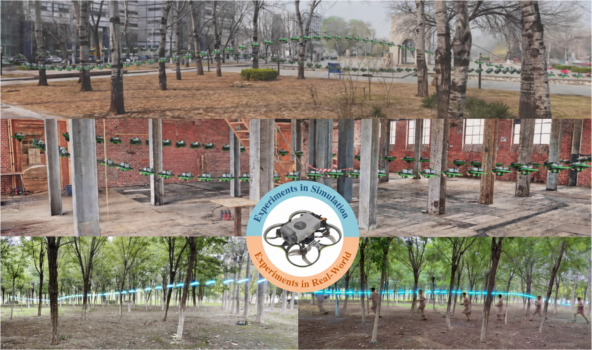

🎬 Watch the paper introduction video on 🌐 [my homepage](https://mioulo.github.io/) or 📺 [Bilibili](https://www.bilibili.com/video/BV1LRnA6REhe/).

## 🎮 Simulation Flights

### 🕹️ Unity

<p align="center">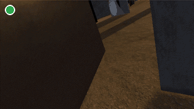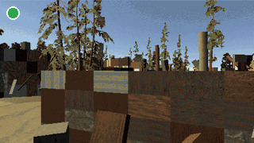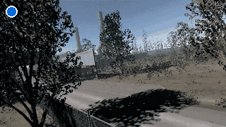<br>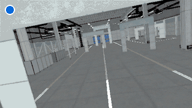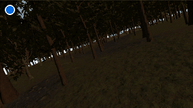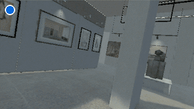<br>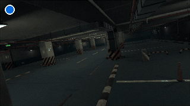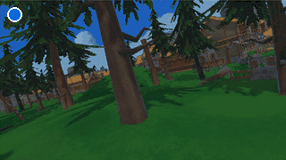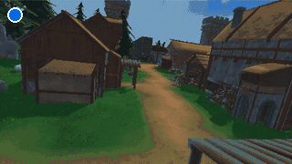</p>

<p align="left"><sub>🟢 Training environments　 🔵 Validation environments</sub></p>

### ✨ 3D Gaussian Splatting (3DGS)

<p align="center">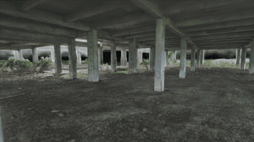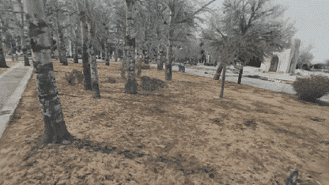<br>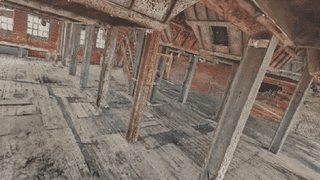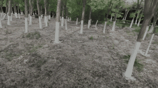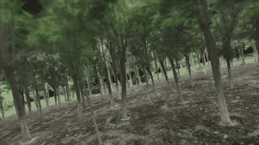</p>

## 🚁 Real-World Flights

<p align="center">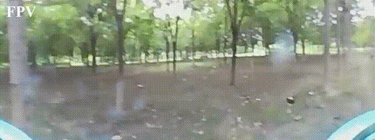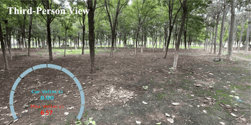</p>

## 🧠 Method

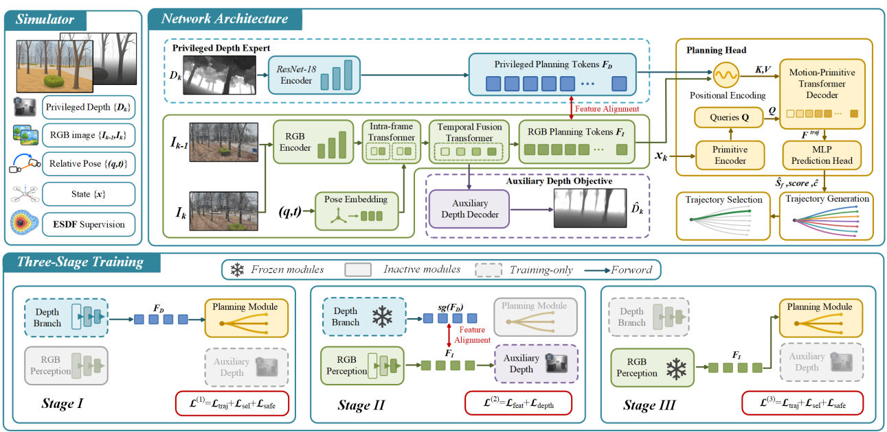

Our monocular planner generates smooth trajectories from **two consecutive RGB images, their metric relative pose, and the vehicle state**. During training, a privileged depth expert transfers planning-relevant geometry to the RGB branch through feature alignment, aided by an auxiliary coarse-depth objective. Pose-conditioned temporal fusion brings together geometric cues across frames.

1. **Learn from depth:** pretrain the depth expert and shared planner with trajectory objectives.
2. **Transfer geometry:** freeze the expert and shared planner; train the RGB branch with feature alignment and auxiliary depth supervision.
3. **Adapt for RGB:** freeze RGB perception and adapt the shared planner to its learned representation.

At deployment, the depth expert and auxiliary depth decoder are removed. The RGB planner selects a smooth trajectory from predicted motion primitives, without explicitly reconstructing depth.

## 🚀 Inference and TensorRT Deployment

<p align="center">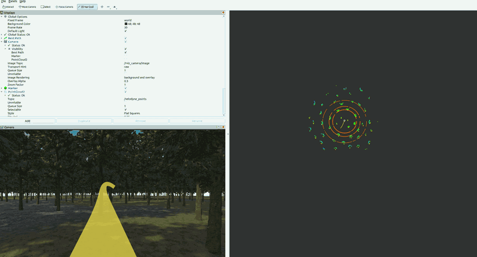</p>

<details>
<summary>Click to expand deployment instructions</summary>

### 1. Environment Setup

The project was tested on **Ubuntu 20.04 with ROS1 Noetic**.
Install ROS1 Noetic and a CUDA-compatible NVIDIA driver before proceeding.

**Clone the repository:**

```bash
git clone https://github.com/TJU-Aerial-Robotics/GeoMonoPlan.git
cd GeoMonoPlan
```

**Create the Python environment and install dependencies:**

```bash
conda create -n geomonoplan python=3.8.20 -y
conda activate geomonoplan
python -m pip install -r requirements.txt
```

On Linux x86_64, this installs CUDA-enabled PyTorch, ONNX, and the full
**TensorRT 11.1.0.106** builder/runtime. The same environment supports PT
inference, TensorRT export and engine inference. For Jetson, install the
PyTorch and TensorRT packages matched to JetPack.

**Download the simulator and checkpoint:**

The **standalone simulation environment** and **PT checkpoint** are available
from [Releases](https://github.com/TJU-Aerial-Robotics/GeoMonoPlan/releases).
Place the checkpoint at `weights/geomonoplan.pt`. The checkpoint contains the
complete inference weights; no separate YOLO weight download is required.
Download `AeroScene.zip` to the repository root, then create `Simulator` and
extract the environment into it:

```bash
mkdir -p Simulator/AeroScene
unzip AeroScene.zip -d Simulator/AeroScene
```

Keep all extracted simulator files together.

### 2. Build the Controller

Use a ROS terminal outside Conda. From the repository root:

```bash
conda deactivate
source /opt/ros/noetic/setup.bash
cd Controller
catkin_make -DPYTHON_EXECUTABLE=/usr/bin/python3
cd ..
```

### 3. Set Up Unity–ROS Communication

Create a separate `unity_ros` workspace inside `Simulator`, alongside
`AeroScene`. From the repository root, in the same ROS terminal:

```bash
mkdir -p Simulator/unity_ros/src
git clone https://github.com/Unity-Technologies/ROS-TCP-Endpoint.git Simulator/unity_ros/src/ros_tcp_endpoint
cd Simulator/unity_ros
catkin_make -DPYTHON_EXECUTABLE=/usr/bin/python3
cd ../..
```

If you already have `ros_tcp_endpoint`, reuse its workspace and source its
`devel/setup.bash` when starting the endpoint below.

### 4. Start the Simulation Environment

Our simulation environment is based on
[YOPO-Sim](https://github.com/TJU-Aerial-Robotics/YOPO-Sim).

The startup order is **select environment → Respawn → start the ROS modules
and planner → ROS connect**.

**Launch Unity** from the repository root:

```bash
cd Simulator/AeroScene
chmod +x AeroScene.x86_64
./AeroScene.x86_64
```

Alternatively, double-click `AeroScene.x86_64` in the file manager after granting
execute permission.

| Index | Environment |
| --- | --- |
| `0` | Forest |
| `1` | Cluttered environment |
| `2` | Garage |

Enter the index in the environment selector and click the switch button before
clicking **Respawn**.

**Start the ROS modules.** In each ROS terminal, start from the repository root
and source the workspace:

```bash
source /opt/ros/noetic/setup.bash
source Controller/devel/setup.bash
```

**Terminal 1 — controller and flight dynamics:**

```bash
roslaunch so3_quadrotor_simulator simulator_attitude_control.launch
```

**Terminal 2 — Unity ROS endpoint:**

```bash
source Simulator/unity_ros/devel/setup.bash
roslaunch ros_tcp_endpoint endpoint.launch tcp_ip:=127.0.0.1 tcp_port:=10000
```

**Terminal 3 — forward the simulated pose to Unity:**

```bash
rosrun topic_tools transform /sim/odom /drone_0/pose geometry_msgs/Pose 'm.pose.pose' --tcpnodelay
```

Use `127.0.0.1:10000` for simulation on the same machine. Start one of the
planner backends below, then click **ROS connect** once all ROS modules are
ready. The controller subscribes to `/so3_control/pos_cmd` and the flight dynamics
simulator publishes `/sim/odom`. The pose-forwarding node moves the Unity camera,
and Unity publishes `/rgb/image`.

### 5. Run PT Inference

Keep the simulation running. In a new terminal, from the repository root:

```bash
conda activate geomonoplan
source /opt/ros/noetic/setup.bash
source Controller/devel/setup.bash
python scripts/run_planner.py --backend pt
```

Set `ros.verbose: true` in `config/inference.yaml` to view processing latency.
If inference latency is high, reduce the planning frequency. We recommend TensorRT deployment for lower inference latency.

The planner loads `weights/geomonoplan.pt`. Configure the initial goal point (default: `(50, 0, 2)`) in
[config/inference.yaml](config/inference.yaml).
Send goal points on `/move_base_simple/goal`, for example using **2D Nav Goal**
in RViz. Load the provided [RViz configuration](vis_fly.rviz) from the repository
root in a ROS terminal:

```bash
rviz -d vis_fly.rviz
```

| Interface | Default topic |
| --- | --- |
| RGB input | `/rgb/image` |
| Odometry input | `/sim/odom` |
| Goal input | `/move_base_simple/goal` |
| Reference command output | `/so3_control/pos_cmd` |
| Planned path output | `/trajectory` |

### 6. Export TensorRT Engines

We provide a one-command TensorRT deployment script. We recommend exporting
the engines on the target GPU and using engine inference for deployment:

```bash
conda activate geomonoplan
python scripts/export_engine.py --precision fp16
```

The script exports the models, builds FP16 engines and reports numerical checks:

```text
engines/
├── encoder.engine
└── planner.engine
```

Build on the deployment machine and keep both engines from the same export together.

### 7. Run Engine Inference

With the simulation running, start the engine backend from the repository root:

```bash
conda activate geomonoplan
source /opt/ros/noetic/setup.bash
source Controller/devel/setup.bash
python scripts/run_planner.py --backend engine
```

The engine backend uses the same ROS interfaces as PT inference. For a real
platform, configure the image, odometry and command topics and camera pitch in
`config/inference.yaml`.

### Inference Performance Reference

<table>
  <tr>
    <td valign="top">
      <table>
        <tr><th>Component</th><th>Configuration</th></tr>
        <tr><td>CPU</td><td>Intel Core i9-11900 (8 cores / 16 threads)</td></tr>
        <tr><td>RAM</td><td>32 GB</td></tr>
        <tr><td>GPU</td><td>NVIDIA GeForce RTX 3070 (8 GB)</td></tr>
        <tr><td>System</td><td>Ubuntu 20.04 / ROS1 Noetic</td></tr>
      </table>
    </td>
    <td valign="top">
      <table>
        <tr><th>Backend</th><th>Inference latency</th></tr>
        <tr><td>PyTorch</td><td>≈14.1 ms</td></tr>
        <tr><td>TensorRT FP16</td><td>≈2.9 ms</td></tr>
      </table>
    </td>
  </tr>
</table>

</details>

## 🛠️ Real-World Deployment

<table>
  <tr>
    <td rowspan="6" width="36%" align="center" valign="middle">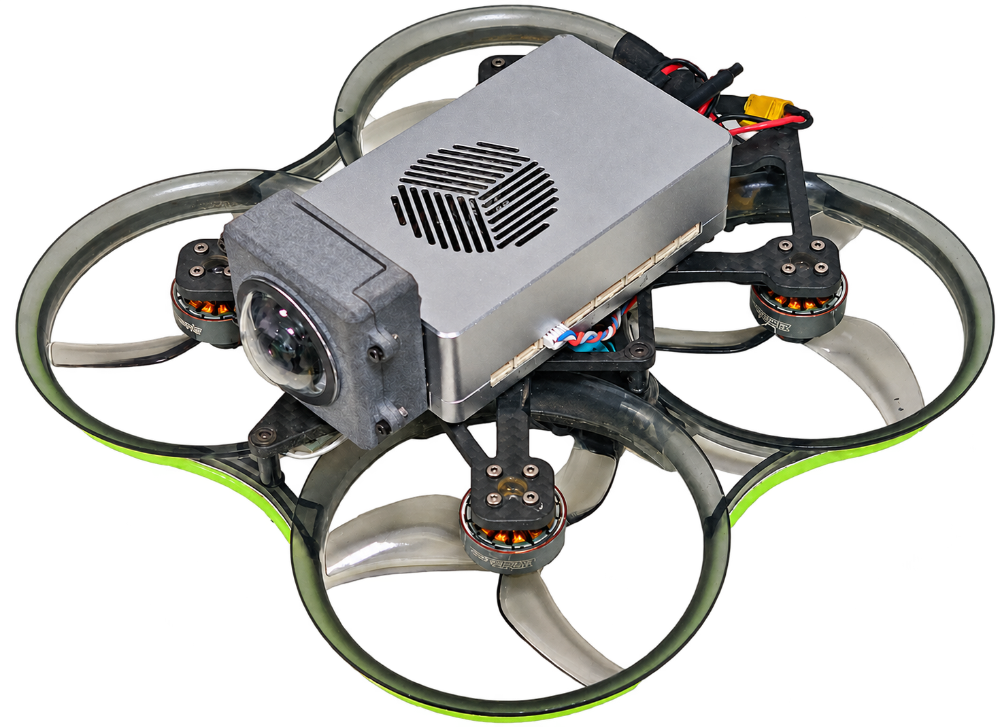</td>
    <th>Component</th><th>Configuration</th>
  </tr>
  <tr><td>Onboard computer</td><td>NVIDIA Jetson Orin NX</td></tr>
  <tr><td>Visual sensor</td><td>Monocular fisheye camera</td></tr>
  <tr><td>State estimation</td><td>VINS-Mono with calibrated fisheye images and IMU</td></tr>
  <tr><td>Onboard pipeline</td><td>State estimation, planning, and control</td></tr>
  <tr><td>Sim-to-real transfer</td><td>No real-world fine-tuning</td></tr>
</table>

## 🤗 Citation

```bibtex
@misc{feng2026geomonoplan,
  title         = {Learning Geometry-Aware Planning Representations for Monocular Flight with Cross-Modal Supervision},
  author        = {Wencan Feng and Bailing Tian and Yulin Hui and Zhiyu Li and Junjie Lu},
  year          = {2026},
  eprint        = {2610.26508},
  archivePrefix = {arXiv},
  primaryClass  = {cs.RO},
  doi           = {10.48550/arXiv.2610.26508},
  url           = {https://arxiv.org/abs/2610.26508}
}
```

## 🙏 Acknowledgments

We thank the authors of the following open-source projects:

- [YOPO](https://github.com/TJU-Aerial-Robotics/YOPO) for the planning framework.
- [YOPO-Sim](https://github.com/TJU-Aerial-Robotics/YOPO-Sim) for the simulation environment.
- [Ultralytics YOLO](https://github.com/ultralytics/ultralytics) for YOLO26-Depth and its pretrained weights.

## 📌 Note!!!

The paper has not yet been accepted for publication, and the full code is not yet open source. The publicly available code has minor differences from the implementation described in the paper.

## License

Original code and documentation are released under the [MIT License](LICENSE). Third-party components retain their original licenses and copyright notices.
